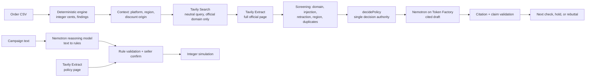

# MarginGuard

**Check the fix before you ship it.** MarginGuard finds where a small online store is losing margin, then tests the suggested fix against live official policy before the seller acts on it.

[Live demo](https://marginguard.marginguard-demo.workers.dev) · [Offline mirror](https://allenllii.github.io/marginguard/) · [Demo video](__VIDEO_URL__) · [Spec](docs/SPEC.md) · [Architecture](docs/ARCHITECTURE.md)

Built for the Nebius x NVIDIA Global AI Hackathon: **Best Apps and Agents** track, **Best Use of Tavily** prize.

## The problem

A seller sees discounts eating margin. The usual advice, from dashboards and chatbots alike, is "tighten your discount combination settings." On Shopify that advice is a no-op for a whole class of discounts: custom discounts applied manually in POS or on draft orders apply regardless of combination settings. The seller flips the toggle, nothing changes, and the leak continues.

Generic AI advice fails here because it never checks the platform's own rules against the seller's situation.

## What MarginGuard does

1. **Finds the leak with exact math.** Import an order CSV. Deterministic code computes contribution in integer cents and flags discount stacking, shipping overruns and return spikes. Every finding shows its formula, its source rows and the seller assumptions behind it.
2. **Challenges the proposed fix with live policy.** For the flagged issue, MarginGuard sends **Tavily Search** a neutral query (it names the topic, not the answer we expect) restricted to the platform's own domain, then **Tavily Extract** pulls the official page so the rule engine reads full sentences instead of a cut-off snippet. The rule engine decides whether that text applies to the seller's context. For the two Shopify discount-combination pages we reviewed (manual/POS and automatic/code origins), the result also says if the official page has changed since our review; other pages have no reviewed copy to compare against.
3. **Changes the next action, not the numbers.** In the demo case Tavily returns Shopify's POS policy: *"Custom discounts that you apply manually in Shopify POS always apply to the order, even if other discounts have combination restrictions."* The settings fix is rebutted, and the next check becomes an audit of staff/manual overrides. Same 28 rows, same $658.08 modeled exposure, different action.
4. **Holds when context is missing.** An unknown discount origin, a non-US region, an app whose discount mechanism is unknown, or Shopify Scripts (retired by Shopify on 2026-06-30) holds the recommendation whatever the sources say. A retracted or contrary passage also holds; no passage, or passages that conflict, return "not enough evidence".
5. **Drafts the check with NVIDIA Nemotron on Nebius Token Factory.** Code supplies the policy statement behind each citation; Nemotron-3.5-Lightning writes the hypothesis, the validation step and the uncertainty. Code checks every citation against the returned sources and rejects numbers in the prose. A held or under-evidenced case never reaches the model.
6. **Tests a promotion before launch.** In Promo Preflight, describe a campaign in plain English. Nemotron 3 Super turns it into structured rules; code checks every value against the campaign text and against a local parser where one applies. Tavily pulls the governing policy page, the seller confirms, and an integer simulator finds the worst cart. The built-in sample walkthrough shows how stacking can turn a $50 cart into **−$6.00 contribution**.

7. **Checks any fix you paste in.** In **Check a fix**, type advice from any assistant ("shorten the return window to 14 days", "tighten discount combination settings"). Code picks the official site from the fix's wording; Nemotron-3.5-Lightning writes the testable claim and a search query; Tavily Search + Extract fetch the official page; Nemotron 3 Super judges supported / contradicted / not enough evidence with quotes; and code accepts only quotes that appear verbatim in the Tavily text. On a frozen 8-item list the third run matched the expected verdict 7/8 times ([eval and limits](docs/CHECK-ANY-FIX.md)); it is a model judgment with verified quotes, not legal advice.
8. **Watches the policy pages decisions depend on.** **Policy watch** (in Data & method) re-extracts the reviewed Shopify pages with one Tavily Extract call and reports unchanged / changed / unavailable against the fingerprints our decisions were reviewed on ([how](docs/POLICY-WATCH.md)).

## How the sponsor technology is used



| Technology | Where | What it does |
| --- | --- | --- |
| **Tavily Search** | `server/tavily.ts` | Fixed, neutral queries (never order data), `include_domains` restricted to help.shopify.com, woocommerce.com, usps.com or ups.com; results are screened and de-duplicated. In the recorded live cases (manual and automatic/code Shopify discounts, USPS shipping) the retrieved text decides the verdict; other offline contexts use authored policy summaries, labelled as such. |
| **Tavily Extract** | `server/tavily.ts`, `server/preflight-policy.ts` | Pulls the full official page after Search so the decision reads complete sentences, and flags a change on the reviewed Shopify discount-combination pages; in Promo Preflight, pulls the reviewed policy page before any rule is proposed. |
| **Nebius Token Factory** | `server/nebius.ts`, `server/preflight-intent.ts` | OpenAI-compatible API; model IDs verified with `GET /v1/models` before each call. |
| **NVIDIA Nemotron-3.5-Lightning** | cited policy draft, analyst brief | Fast structured drafts: the recorded policy draft (request `0e8fed4b58636dcfe3c7410ed03a85e3`) took 1.3 s and 892 input / 188 output tokens, and writes the store-operator procedure that follows the code's decided check. The last live brief failed the no-digits check and fell back; its prompt now sends no numbers, and that change has not been re-run live. |
| **NVIDIA Nemotron 3 Super** | Promo Preflight | Reasoning model that turns free-form campaign text into rules; code checks each value against the text and a local parser before the seller confirms. |

The model never computes money or decides eligibility. Those stay in `server/analysis.ts`, `shared/policy-decision.ts` and `shared/preflight.ts`.

## A real live run

The current pipeline, end to end through the local app on 2026-10-30: Shopify / US / manual discount origin, synthetic Northstar data ([ledger](evidence/live-e2e-20261030.json)). The hosted demo replays this run for the manual case: the Tavily packet from attempt 5 and the Nemotron draft from attempt 6, whose sources were byte-identical.

| Call | Result |
| --- | --- |
| Tavily advanced Search, help.shopify.com | request `515542b8-52d0-4ef4-859a-053ebafcf71e`, 2 credits; three official pages (attempt 6 repeated it as `455a4add-b948-449d-bff7-e17a158de57e` with byte-identical sources) |
| Tavily Extract, top two pages | request `9979922b-4628-4755-a47b-3053b1bfc222`; complete operative sentences from the Combining discounts and POS pages |
| Decision (code) | contradicted on S1, S2: the combination-settings fix is rebutted → "Audit staff/manual POS and draft-order overrides, permissions, and promotion intent before changing combination settings." |
| Nemotron-3.5-Lightning draft (structured output) | request `0e8fed4b58636dcfe3c7410ed03a85e3`, 892 input / 188 output tokens, 1.3 s; **passed validation** on the first call |

Nemotron's part is the hypothesis and the procedure that carries out the code's check. Its recorded procedure: "Open the sales channel order list and filter for flagged orders. For each order, examine the discount line to identify who applied the manual discount and compare the applied amount against the planned promotion. Verify the order timeline and location against staff permissions and the promotion eligibility window." It then states which result supports the hypothesis and which rules it out. The policy sentences beside each citation are written by code, and the validator rejects a next step that restates the code's check.

It took six end-to-end attempts. Tavily returned byte-identical sources every time. The Nemotron draft failed validation in attempts 1, 2 and 4 (bare citation IDs, a next step that repeated the rebutted fix, an unrecorded reason); attempt 3's draft was later rejected for saying the exception "explains the exposure"; attempt 5's draft passed, but its next step was the code's check word for word. We fixed each cause in code (accept bare IDs, reject contradicting, causal or copied next steps, name the failed check), switched the draft call to Token Factory's JSON-schema structured output, and asked for a concrete admin procedure. Attempt 6 passed on the first call. All six attempts are in the ledger.

## Try it

**Live demo (no account, no keys).** [Open the live demo](https://marginguard.marginguard-demo.workers.dev). It runs on Cloudflare Workers with real Tavily and Nemotron calls behind a durable budget: each provider allows 6 calls a minute, 60 a day and 300 in total, recorded in a D1 ledger before every call, until December 24, 2026. Click **See the discount policy counterexample**, tick the consent box, then **Search official policies** (Tavily Search + Extract) and **Draft with Nemotron**; switch the discount origin between *Manual / POS / draft* and *Unknown* to watch the next check change. In Promo Preflight, type your own campaign and let Nemotron 3 Super turn it into rules. When the daily budget is used up, the app says so and the recorded runs remain available.

**Offline mirror.** [allenllii.github.io/marginguard](https://allenllii.github.io/marginguard/) runs the same build entirely in your browser with no provider calls. It replays recorded Tavily Search + Extract responses for the manual, automatic/code and USPS cases, the recorded Nemotron draft, and the recorded Nemotron 3 Super campaign interpretation, each labelled as recorded.

**Run locally (offline).**

```sh
npm ci --ignore-scripts
npm run dev        # http://127.0.0.1:3000
```

**Run locally with live Tavily + Nemotron.** Create `.env.local`:

```sh
TAVILY_API_KEY=...
TAVILY_ENABLE_LIVE=true
NEBIUS_API_KEY=...
NEBIUS_ENABLE_LIVE=true
NEBIUS_MODEL=nvidia/Nemotron-3_5-Lightning
NEBIUS_REASONING_MODEL=nvidia/nemotron-3-super-120b-a12b
```

Then `npm run dev`, open the counterexample, tick the consent box and click **Search official policies**, then **Draft with Nemotron**. Set `LIVE_MINUTE_LIMIT=4` or more (Check a fix needs three Nebius calls in one go); by default each provider is capped at 2 calls/minute, 20/day and 100 per process by default.

Requires Node.js 24.19+.

## Safety and privacy by design

- Raw rows, order IDs, product names and file names never enter a search query or prompt; only aggregate metrics and short cited passages reach the model.
- CSVs are processed in memory (in your browser on the hosted demo) and not stored.
- Tavily results are restricted to official domains and screened for prompt-injection text, retractions, regional scope and duplicates.
- Model output is schema-validated; citations must reference returned sources; digits in model prose are rejected so money stays in code.
- Provider calls need explicit consent, are rate- and budget-capped, never retried silently, and every failure is shown.

## Synthetic data and golden numbers

Seed 73021 generates 504 orders (September 1-28, 2026) with three planted issues. `npm run evaluate` checks them against [ground truth](data/ground-truth.json).

| | Value |
| --- | ---: |
| Net revenue | $39,846.22 |
| Contribution | $22,077.83 |
| Return spike (CLOUD-HOODIE) | $1,040.00 / 14 rows |
| Stacked discounts | $658.08 / 28 rows |
| Shipping overrun | $220.50 / 21 rows |

Modeled exposure is a review candidate, not realized savings. Discount ceiling (default 20%) and shipping allowance (default $3) are editable seller assumptions, not platform rules. CSV format: [template](data/template.csv); UTF-8, USD, up to 2 MiB / 10,000 rows.

## Benchmark: what retrieval did and did not do

We preregistered a small with- vs without-retrieval benchmark ([preregistration](docs/benchmark/PREREGISTRATION.md), [results](docs/benchmark/RESULTS.md)): 24 synthetic holdout cases written by an independent AI agent, the same Nemotron-3.5-Lightning prompt, schema and parameters in both arms, two replicates, scoring blind to arm.

**Result: the frozen Tavily package did not improve the model's decisions.** Nemotron answered "insufficient" in 93 of 96 outputs with or without sources; on the 8 applicable-policy cases the with-sources arm scored 0.875 vs 1.000 (p = 1.0, too few families to detect a difference). The main limit was retrieval coverage in the harness's fixed basic query: only 4 of 24 packages contained the page the gold relies on. All roles were AI agents; no human reviewed the gold. Cost: 24 Tavily credits and about 97k Nebius tokens (estimated USD 0.20; invoices not checked).

**Follow-up after the retrieval redesign** ([preregistration](docs/benchmark/FOLLOWUP-PREREGISTRATION.md), [results](docs/benchmark/FOLLOWUP-RESULTS.md)). The same 24 cases rerun with the product's current Tavily Search → Extract pipeline: packages containing the gold-cited official page rose from **4/24 to 8/24** (US cases 3/16 → 8/16). The model still did not use it well: with the gold page present it answered "insufficient" 13 of 16 times, and the with-sources arm scored 0.69 vs 1.00 on the applicable cases (not significant, 4 families). The screening also dropped the gold WooCommerce page in 3 cases; the cause (ordinary coupon prose matching a retraction pattern) is fixed with a regression test, but the fix has not been re-benchmarked. This is a follow-up on the same cases that motivated the change, not a confirmatory test.

What this means for the product: MarginGuard does not rely on the model to decide applicability. Code decides from the retrieved text; with no usable passage the answer is "not enough evidence", and missing context is a hold. The neutral-query Search → Extract design responds to the coverage problem above; it has not been re-benchmarked.

## Tests

`npm run check` runs lint, strict TypeScript, the frontend and Worker builds, 367 unit/API tests, 65 benchmark-harness tests and the synthetic routing evaluation. Browser tests (`npm run start:qa`, then `npm run test:ui`) run 100 Playwright scenarios covering keyboard use, 320-375px layouts, reduced motion, failure states and privacy.

## Limits

All data is synthetic and there is no store connection: the seller supplies the discount origin. The policy rules cover a deliberately small set of Shopify, WooCommerce, USPS and UPS cases. The live demo is capped per provider (see above); the offline mirror replays recorded runs.

## Project layout

```
server/   analysis, provider adapters (tavily, nebius, preflight-*), orchestration, Express adapter
shared/   pure logic shared by server, Worker and UI: policy decision, preflight simulation, types
src/      React UI (no money or eligibility logic)
worker/   Worker entry points (live and forced-offline)
tests/    unit/API tests and Playwright specs
data/     synthetic dataset, template, ground truth
docs/     spec, architecture, feature notes; docs/history holds earlier process notes
```

MIT licensed; see [LICENSE](LICENSE).
