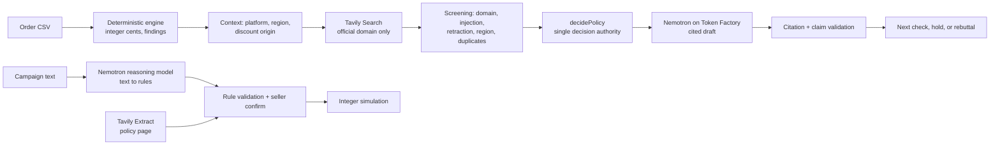

# MarginGuard

**Check the fix before you ship it.** MarginGuard finds where a small online store is losing margin, then tests the suggested fix against live official policy before the seller acts on it.

[Live demo](https://allenllii.github.io/marginguard/) · [Demo video](__VIDEO_URL__) · [Spec](docs/SPEC.md) · [Architecture](docs/ARCHITECTURE.md)

Built for the Nebius x NVIDIA Global AI Hackathon: **Best Apps and Agents** track, **Best Use of Tavily** prize.

## The problem

A seller sees discounts eating margin. The usual advice, from dashboards and chatbots alike, is "tighten your discount combination settings." On Shopify that advice is a no-op for a whole class of discounts: custom discounts applied manually in POS or on draft orders apply regardless of combination settings. The seller flips the toggle, nothing changes, and the leak continues.

Generic AI advice fails here because it never checks the platform's own rules against the seller's situation.

## What MarginGuard does

1. **Finds the leak with exact math.** Import an order CSV. Deterministic code computes contribution in integer cents and flags discount stacking, shipping overruns and return spikes. Every finding shows its formula, its source rows and the seller assumptions behind it.
2. **Challenges the proposed fix with live policy.** For the flagged issue, MarginGuard asks **Tavily** for official documentation restricted to the platform's own domain. A rule engine decides whether the retrieved passage applies to the seller's context.
3. **Changes the next action, not the numbers.** In the demo case Tavily returns Shopify's POS policy: *"Custom discounts that you apply manually in Shopify POS always apply to the order, even if other discounts have combination restrictions."* The settings fix is rebutted, and the next check becomes an audit of staff/manual overrides. Same 28 rows, same $658.08 modeled exposure, different action.
4. **Holds when evidence is missing.** Unknown discount origin, the wrong region, an ordinary app mistaken for the Scripts API, or conflicting passages put the recommendation on hold instead of guessing.
5. **Drafts the check with NVIDIA Nemotron on Nebius Token Factory.** Nemotron writes the cited constraint, hypothesis, validation step and uncertainty. Code validates every citation and rejects drafts that change money or upgrade a hold.
6. **Tests a promotion before launch.** In Promo Preflight, describe a campaign in plain English. Nemotron turns it into structured rules, Tavily pulls the governing policy page, the seller confirms, and an integer simulator finds the worst cart, for example a $50 cart that ends at **−$6.00 contribution** once stacked.

## How the sponsor technology is used



| Technology | Where | What it does |
| --- | --- | --- |
| **Tavily Search** | `server/tavily.ts` | Fixed, generic queries (never order data), `include_domains` restricted to help.shopify.com, woocommerce.com, usps.com or ups.com; returned passages are screened, de-duplicated and passed to the decision rule. The passage decides the verdict. |
| **Tavily Extract** | `server/preflight-policy.ts` | Pulls the full reviewed policy page in Promo Preflight before any rule is proposed. |
| **Nebius Token Factory** | `server/nebius.ts`, `server/preflight-intent.ts` | OpenAI-compatible API; model IDs verified with `GET /v1/models` before each call. |
| **NVIDIA Nemotron-3.5-Lightning** | analyst brief, cited policy draft | Fast structured drafts (about 1 s, ~600 input / 100 output tokens). |
| **NVIDIA Nemotron 3 Super** | Promo Preflight | Reasoning model that interprets free-form campaign text into rules that code then validates. |

The model never computes money or decides eligibility. Those stay in `server/analysis.ts`, `shared/policy-decision.ts` and `shared/preflight.ts`.

## A real live run

Recorded from the local app on 2026-10-30 with synthetic data ([ledger](evidence/live-run-20261030.json)):

| Call | Result |
| --- | --- |
| Tavily Search, help.shopify.com | request `19444728-22d2-4be8-ab7e-7c4d0714bb07`, 1 credit, 1.5 s; returned the Shopify POS combination policy |
| Decision | settings fix rebutted → audit manual/POS/draft overrides |
| Nemotron-3.5-Lightning completion | request `31354285bac744de81d06e20979fcac4`, 579 input / 100 output tokens, 1.0 s |

## Try it

**Hosted demo (no account, no keys).** [Open the demo](https://allenllii.github.io/marginguard/), click **See the discount policy counterexample**, then switch the discount origin between *Manual / POS / draft* and *Unknown* to watch the next check change. The hosted build runs offline: it replays the recorded live Tavily and Nemotron responses above and labels them as recorded. It makes no provider calls.

**Run locally (offline).**

```sh
npm ci --ignore-scripts
npm run dev        # http://127.0.0.1:3000
```

**Run locally with live Tavily + Nemotron.** Create `.env.local`:

```sh
TAVILY_API_KEY=...
TAVILY_ENABLE_LIVE=true
NEBIUS_API_KEY=...
NEBIUS_ENABLE_LIVE=true
NEBIUS_MODEL=nvidia/Nemotron-3_5-Lightning
NEBIUS_REASONING_MODEL=nvidia/nemotron-3-super-120b-a12b
```

Then `npm run dev`, open the counterexample, tick the consent box and click **Search official policies**, then **Draft with NVIDIA**. Each provider is capped at 2 calls/minute, 20/day and 100 per process by default.

Requires Node.js 24.19+.

## Safety and privacy by design

- Raw rows, order IDs, product names and file names never enter a search query or prompt; only aggregate metrics and short cited passages reach the model.
- CSVs are processed in memory for the calculation and not stored.
- Tavily results are restricted to official domains and screened for prompt-injection text, retractions, regional scope and duplicates.
- Model output is schema-validated; citations must reference returned sources; digits in model prose are rejected so money stays in code.
- Provider calls need explicit consent, are rate- and budget-capped, never retried silently, and every failure is shown.

## Synthetic data and golden numbers

Seed 73021 generates 504 orders (September 1-28, 2026) with three planted issues. `npm run evaluate` checks them against [ground truth](data/ground-truth.json).

| | Value |
| --- | ---: |
| Net revenue | $39,846.22 |
| Contribution | $22,077.83 |
| Return spike (CLOUD-HOODIE) | $1,040.00 / 14 rows |
| Stacked discounts | $658.08 / 28 rows |
| Shipping overrun | $220.50 / 21 rows |

Modeled exposure is a review candidate, not realized savings. Discount ceiling (default 20%) and shipping allowance (default $3) are editable seller assumptions, not platform rules. CSV format: [template](data/template.csv); UTF-8, USD, up to 2 MiB / 10,000 rows.

## Benchmark: what retrieval did and did not do

We preregistered a small with- vs without-retrieval benchmark ([preregistration](docs/benchmark/PREREGISTRATION.md), [results](docs/benchmark/RESULTS.md)): 24 synthetic holdout cases written by an independent AI agent, the same Nemotron-3.5-Lightning prompt, schema and parameters in both arms, two replicates, scoring blind to arm.

**Result: the frozen Tavily package did not improve the model's decisions.** Nemotron answered "insufficient" in 93 of 96 outputs with or without sources; on the 8 applicable-policy cases the with-sources arm scored 0.875 vs 1.000 (p = 1.0, too few families to detect a difference). The main limit was retrieval coverage in the harness's fixed basic query: only 4 of 24 packages contained the page the gold relies on. All roles were AI agents; no human reviewed the gold. Cost: 24 Tavily credits and about 97k Nebius tokens (estimated USD 0.20; invoices not checked).

What this means for the product: MarginGuard does not rely on the model to decide applicability. The decision comes from code over the retrieved passage, and when the passage is missing the answer is a hold.

## Tests

`npm run check` runs lint, strict TypeScript, the frontend and Worker builds, 317 unit/API tests, 65 benchmark-harness tests and the synthetic routing evaluation. Browser tests (`npm run start:qa`, then `npm run test:ui`) run 77 Playwright scenarios covering keyboard use, 320-375px layouts, reduced motion, failure states and privacy.

## Limits

All data is synthetic and there is no store connection: the seller supplies the discount origin. The policy rules cover a deliberately small set of Shopify, WooCommerce, USPS and UPS cases. Live mode runs locally with your own keys; the hosted demo replays a recorded run.

## Project layout

```
server/   analysis, provider adapters (tavily, nebius, preflight-*), orchestration, Express adapter
shared/   pure logic shared by server, Worker and UI: policy decision, preflight simulation, types
src/      React UI (no money or eligibility logic)
worker/   Worker entry points (live and forced-offline)
tests/    unit/API tests and Playwright specs
data/     synthetic dataset, template, ground truth
docs/     spec, architecture, feature notes; docs/history holds earlier process notes
```

MIT licensed; see [LICENSE](LICENSE).
