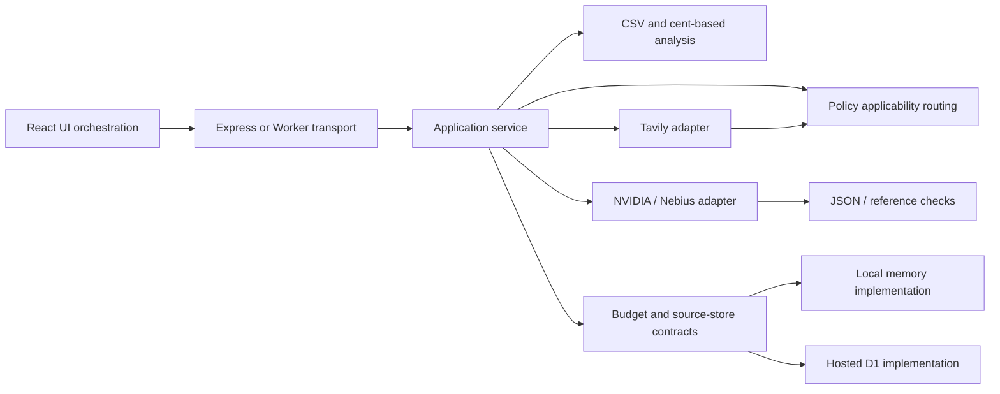

# Module boundaries and review map

One canonical TypeScript source produces the local Express app and the portable Worker ESM. The Worker build embeds the existing Vite assets and bundles the same domain/provider/service modules; it is not a separate product rewrite.

| Boundary | Responsibility | Contract / verification |
| --- | --- | --- |
| `server/analysis.ts` | Validated CSV, integer-cent math, stable exact-SKU SHA-256 IDs, configurable bounded seller assumptions | `Analysis`, `Assumptions`; manual cent tests, collision regressions, golden rows, invariant checks |
| `shared/policy-decision.ts` | Conservative applicability/status/next-check routing | `PolicyDecision`; pure context + visible passages, twelve declared synthetic cases; never an LLM validation claim |
| `server/tavily.ts` | Generic safe query plans, official-domain screening, operative excerpt selection, provider errors/provenance | `ResearchPacket`; fetch injected in tests, no raw CSV or costs in search |
| `server/nebius.ts` | NVIDIA catalogue verification, structured explanation/remediation, reference checks and honest fallback | `Explanation`, `Remediation`; no source amount mutation or tool execution; semantic fidelity remains a human gate |
| `server/http.ts` | Streamed upstream/body byte limits and UTF-8/JSON handling | Standard Web APIs; early cancellation regression |
| `server/service.ts` | API use-case orchestration and validation, not rendering or money rules | Injected `LiveBudget`, `ResearchStore`, `fetch`, clock; both transports share it |
| `server/budget.ts` | Attempt reservations before upstream requests, daily/total/minute limits | Memory scope is process-only; D1 uses atomic SQL, tested against SQLite and new-instance/concurrent reservations |
| `server/app.ts`, `worker/entry.ts` | Host/origin/body/security-header and deployment boundaries | Express local transport; standard-API Worker with no Node builtins, embedded assets, offline smoke tests |
| `src/App.tsx`, `src/PolicyResearch.tsx` | UI state and request orchestration | Dataset generation/request identity + abort; delayed explanation, delayed policy, repeated reset and overlapping import browser regressions |
| `scripts/` | Reproducible generation/evaluation/build/recording | Offline checks never load live keys; explicit live scripts require enabled approved credentials and produce observed provenance only |

CSV content is transient. Hosted durable tables contain request counts and short public policy packets, never orders, product names, customer identities, or API keys. Runtime secrets come only from approved server environment variables and are never inserted into client assets or the hosting manifest.

The public demo fails closed for live calls without a migrated durable budget and verified provider-level hard caps. A database/schema or provider failure is not silently treated as a live success. The UI can still run deterministic analysis and explicitly labeled fixtures.

Known review limits: source-ID membership is structural, not semantic entailment. Passage selection and applicability rules are conservative heuristics. Provider compatibility and actual policy fidelity need real calls and independent human review. D1 SQL has local regression evidence; actual hosted provisioning/migration and public smoke checks remain release gates.

Independent scoring should use evidence, not win probability: technical 25, coherent product design 25, real-world impact 25, originality 25. Record strong points, defects, severity, supporting files/requests, and a prioritized bounded fix list. Review after real integration/deployment gates, then rerun affected tests and re-review. Preserve the release freeze in `RELEASE.md`.
